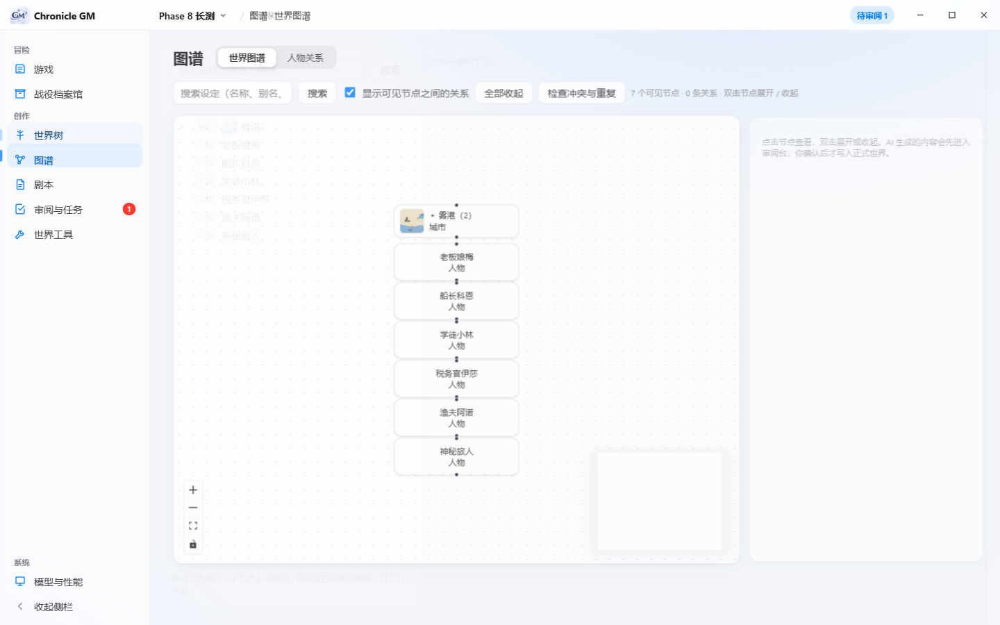
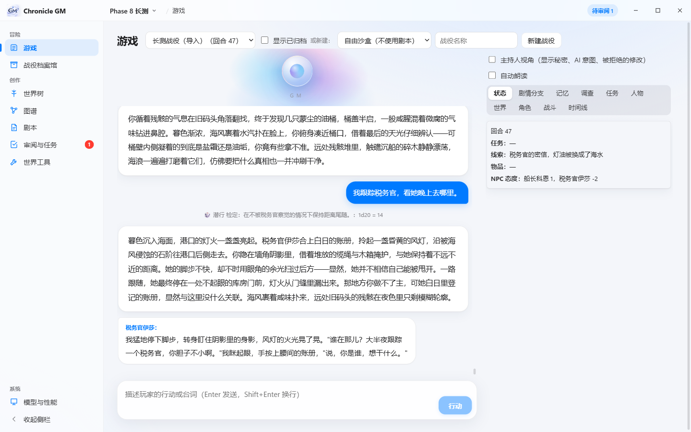
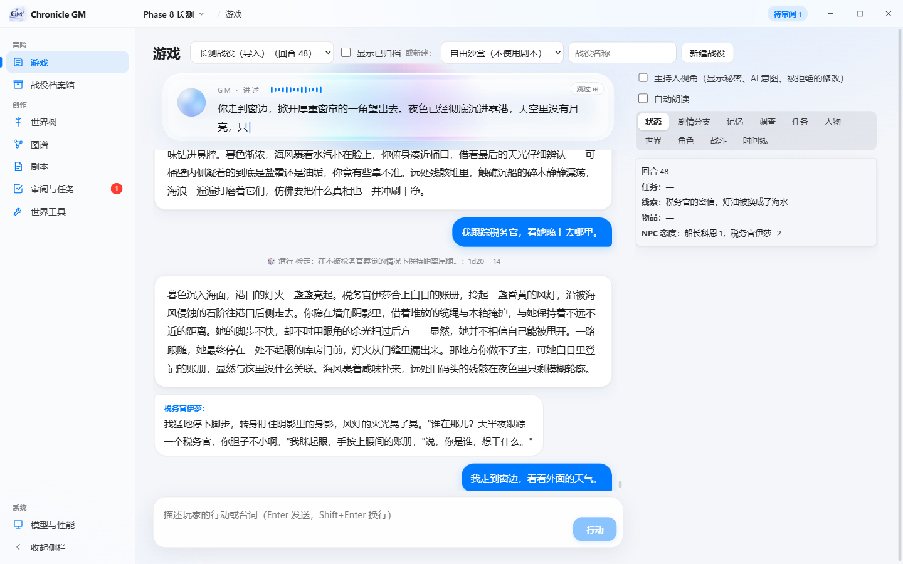

# 第零阶段：修复程序图标 · 界面流畅度与动画 · 完成报告

日期：2026-11-15。截图在 `docs/motion/`。

## Z1 程序图标

- **原因**：项目里的图标文件已经是新的，但 `src-tauri/build.rs` 没有告诉 Cargo"图标变了要重新生成 Windows 资源"。打包时沿用了缓存的 `resource.lib`，exe 里嵌的仍是旧图标，桌面快捷方式和任务栏显示的就是旧图标。安装包外壳用的是新图标，所以看起来"换了一半"。
  - 证据：取 exe 内嵌图标比对中心像素。你装的程序和修复前的本地构建都是 (122, 75, 31)，旧图标的棕色；新的 `icon.ico` 是 (74, 93, 138)。
- **修复**：`build.rs` 声明 `icons/` 与 `tauri.conf.json` 变化时重新生成资源，清掉旧缓存后重新打包。新 exe 的图标中心像素是 (74, 93, 138)，与 `icon.ico` 一致，四角透明。
- **GitHub v0.0.1**：已替换安装包、签名和 `latest.json`。
  - 安装包：8,036,623 字节，SHA-256 `b3832b39c150a50d6980d79fb911858693771ff2fba95b14cf4aa6cef9c8a514`。
  - 从 GitHub 下载回来与上传的一致，软件内测试模式下载并校验签名通过。
- **你的电脑**：需要用新安装包覆盖安装一次。如果桌面图标还是旧的，是 Windows 的图标缓存，运行 `ie4uinit.exe -show` 可以刷新。

## Z2 流畅度与动画

### 测量方法
用脚本在发布版里依次切换 16 个页面 / 分段 / 菜单 / 侧栏，外加一段游戏页静止。每次操作后 1.2 秒内记录：帧数、慢帧（超过 20ms）、最长帧、长任务（超过 50ms）、排版次数。"优化前"用的是你已安装的 0.0.1（改动前的代码），两边用同一份数据。显示器刷新率约 240Hz。

| 指标（17 次操作合计） | 优化前 | 优化后 |
|---|---|---|
| 渲染帧数 | 4,271 | 4,848 |
| 慢帧 | 46（1.1%） | 1（0%） |
| 最长帧 | 108 ms | 92 ms |
| 长任务总时长 | 107 ms | 90 ms |
| 排版次数 | 948 | 926 |

游戏页的变化最大：

| 游戏页 | 优化前 | 优化后 |
|---|---|---|
| 首次打开，1.2 秒内帧数 / 慢帧 | 114 / 24 | 259 / 1 |
| 再次打开 | 63 / 18 | 286 / 0 |
| 静止时 1.2 秒内帧数 | 70（约 58 帧/秒） | 288（约 240 帧/秒） |
| 静止时每秒排版 | 约 60 次 | 0 次 |

### 找到并修掉的问题（都有测量依据）
1. **打开游戏页卡顿约 100ms**：CPU 采样显示 105ms 花在 `scrollIntoView` 上。剧情很长时，它会强制整页重新排版。改为直接滚动剧情容器：第一次打开立即到底，之后有新内容时平滑滚动。
2. **游戏页只有约 60 帧**：逐个移除元素定位到 GM 玻璃球的**液态玻璃**。它的折射滤镜让页面每秒重新排版约 60 次。现在**待命时用 CSS 画的玻璃球**：高光、通透球体、红蓝色散的边缘，几乎不耗资源；**构思和讲述时才挂上真正的液态玻璃**。真实模型实测三种状态都切换正确：待命是 CSS 球 → 构思是液态玻璃 → 讲述是液态玻璃 → 讲完回到 CSS 球。
3. **待命时每秒排版 240 次**：构思用的细弧动画在待命时也在转，而且旋转的是 SVG 里的圆（不走 GPU 合成）。改成只在构思时旋转整个 `<svg>`，交给 GPU 合成，静止时排版降到 0。
4. **打开游戏页时几百行剧情一起播放入场动画**：改成只有新加入的行才浮现。
5. **侧栏大面积毛玻璃**：侧栏背后是静止背景，模糊只是白白耗 GPU，改为半透明底色。

试过但撤回的做法：页面切换时让"选中的导航项、页面标题"等元素用 View Transition 变形过去。实测每次切换多了约 200 次排版（变形会改宽高，不走 GPU）。最后只保留整页滑动和侧栏变形，导航指示块改用 transform 实现。

### 新的动效
- **动效变量**（`ui/src/motion.css`）：统一的时长；三条弹簧曲线由阻尼弹簧数值积分后取样生成 CSS `linear()`：柔和（不回弹）、干脆（约 1% 回弹）、弹跳（约 16% 回弹）。
- **连贯的线性动画**：
  - 页面切换用 View Transition，按导航顺序左右滑入滑出（往下的页面从右边进来，往上的从左边），标题栏和侧栏不跟着滑；
  - 侧栏收起 / 展开时宽度平滑变化；原来那种每帧重新排版的宽度过渡已去掉；
  - 侧栏选中指示块是同一个元素，用弹簧曲线滑到新的选中项；
  - 卡片依次浮现；回合数变化时数字滚动（`AnimatedNumber`）。
- **非线性动画**：世界菜单、引导 / 更新对话框、大图带回弹弹出；角标弹出；按钮按下时快速缩小，松开用弹簧回弹；卡片、预设、场景图悬停时轻微上浮。
- **骨架屏**：页面代码、面板、节点详情、图片加载时显示带微光的灰色块，不再显示"加载中…"文字。
- **预加载**：鼠标停在导航上时预先加载那个页面的代码，切换时不出现空白。
- 系统设置了"减少动态效果"时，过渡、弹簧、微光都会关掉。

## 测试
- 前端：36 个测试通过，类型检查通过。
- 发布版 E2E 走查：22/22 步通过，控制台无错误。View Transition 被下一次点击跳过时的 AbortError 已处理，不再报错。
- 真实模型试玩一回合（托管 llama）：玻璃球状态切换正确，结束后没有残留进程。
- 测量数据：`perf_before.json` / `perf_after.json`（在 scratchpad，脚本 `perf_ui.mjs`）。

## 已知问题
1. 液态玻璃在构思和讲述时仍然每帧排版（这是它的折射实现方式），这段时间游戏页约 60 帧。待命时（大部分时间）已经不受影响。
2. "侧栏收起"的 CLS 数值偏高，是测量脚本用程序点击导致的：真实的鼠标点击会被浏览器排除在 CLS 之外。看排版次数更准确：每次约 120 次，集中在 0.5 秒的变形里，没有慢帧。
3. 计划里的"浮动卡片拖放吸附""骰子翻转""教程里玻璃球飘移"要等对应功能做出来（第一阶段的教程、骰子，第三阶段的智能面板）时，用同一套动效变量实现。

`build.rs` 的修复和本阶段改动都还没有提交。
