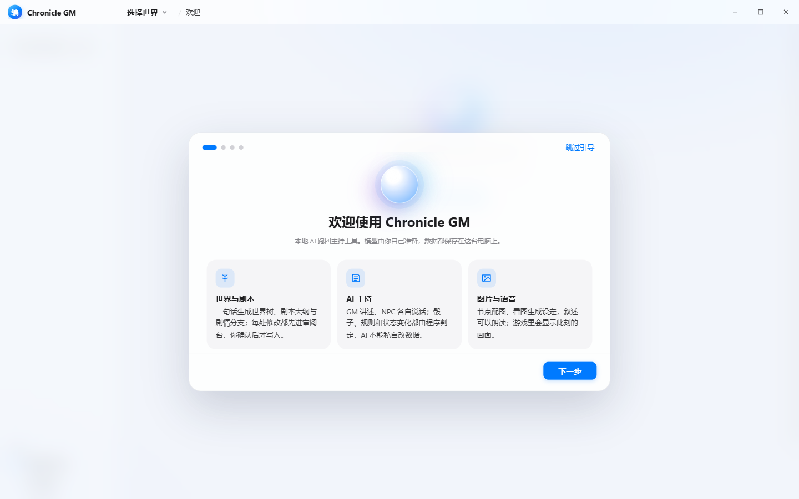
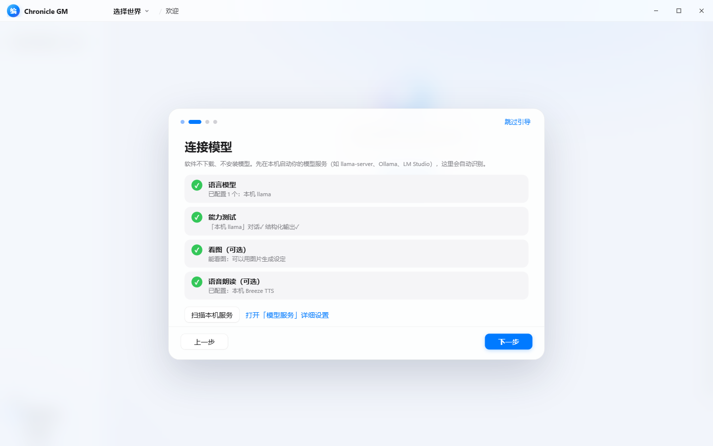
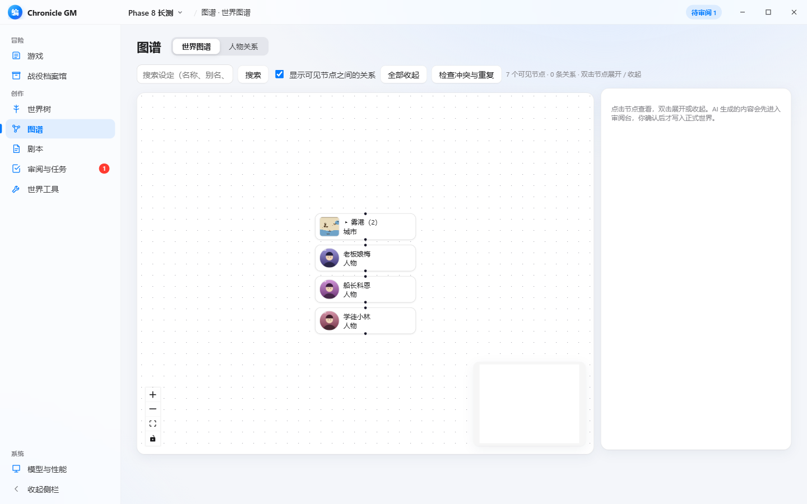
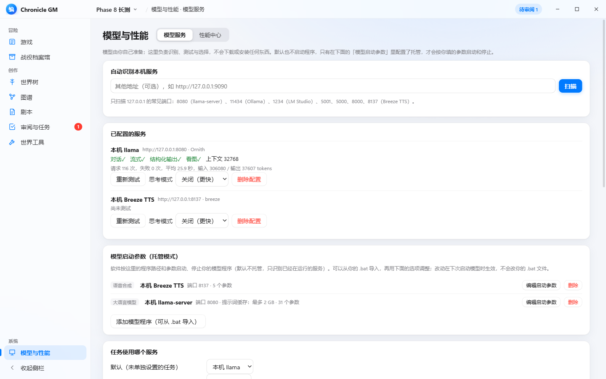
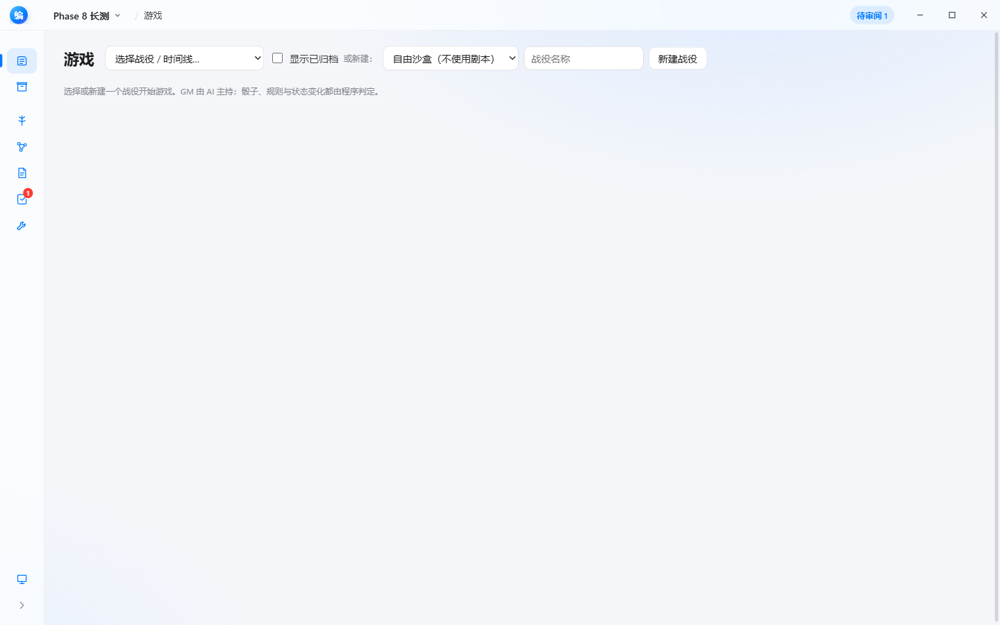

# 自研标题栏 · 布局整理 · 合并重复功能 · 动画 · 使用引导 · 完成报告

日期：2026-11-14。截图在 `docs/ui-shell/`。

## 自研标题栏

窗口不再使用 Windows 的系统标题栏和边框（`decorations: false`）。保留系统阴影和圆角，窗口边缘仍然可以拖动改变大小。

新标题栏的内容：
- 拖动区，双击可以最大化或还原；
- 程序标志；
- **世界菜单**（切换世界、新建世界、使用引导），原来侧栏顶部的世界列表和新建框都移到了这里；
- 当前位置，例如「图谱 · 世界图谱」；
- 状态胶囊：「生成中 N」「待审阅 N」，点一下就能跳过去；
- 自绘的最小化、最大化 / 还原、关闭按钮（关闭按钮悬停时变红）。

窗口权限只多开了拖动、最小化、最大化和关闭这几项。启动失败页也有这个标题栏：没有系统边框时，失败页也必须能拖动和关闭。

## 布局与合并重复功能

所有功能都还在，只是换了入口。

| 原来 | 现在 |
|---|---|
| 侧栏里的「世界图谱」「人物关系」两个页面 | **「图谱」**一个入口，用分段控件切换 |
| 「审阅台」「生成任务」两个页面 | **「审阅与任务」**，角标是待审阅数加上进行中的任务数 |
| 「模型服务」「性能中心」两个页面 | **「模型与性能」** |
| 托管模型的配置在「模型服务」和「性能中心」两处都能添加和编辑（同一个表单出现两次） | 只在「模型服务 → 模型启动参数」里添加、编辑、删除；「性能中心」只负责启动、重启、停止和查看资源，「编辑参数」按钮会跳到模型服务 |
| 侧栏顶部的世界列表、新建世界 | 标题栏的世界菜单 |
| 侧栏底部的版本、模板、数据目录 | 「模型服务」页底部的「关于」 |
| 「检查 · 版本 · 导入导出」 | 「世界工具」 |

另外两处调整：
- 侧栏只放导航，可以收起成只有图标的窄栏，角标仍然显示。收起状态会记住。
- 游戏页会自动打开最近一个进行中的战役，不用每次重新选。

## 动画

- **启动动画**：玻璃球弹出，彩色光晕旋转，细环描出后一直转，名称依次浮现。
  - 动画内联在页面里，脚本加载前就能显示，至少播放 1.4 秒，然后模糊淡出，界面淡入。
  - 淡出用的是定时器而不是 requestAnimationFrame，因为窗口被遮挡时后者会被节流。
- **页面切换**：页面淡入，卡片依次浮现。
- **分段控件**：选中块会滑动到当前项。
- **其他细节**：
  - 侧栏选中项左侧有指示条，收起和展开有过渡；
  - 世界菜单弹出，提示从右侧滑入；
  - 大图放大出现，剧情里新的一段浮现；
  - 按钮按下时轻微缩小。
- 系统设置了"减少动态效果"时，所有动画都会关掉。

## 使用引导

第一次打开时显示，共四步，可以跳过；之后可以从标题栏的世界菜单或欢迎页再次打开。

1. **欢迎**：介绍三大功能。
2. **连接模型**：实时检查语言模型、能力测试、看图、语音是否已经配置；可以一键扫描本机服务，或跳到「模型服务」。
3. **创建第一个世界**：直接输入名称创建，或者打开已有的世界。
4. **常用位置**：介绍主要页面各在哪里。

是否看过引导、侧栏是否收起，都存在资料库里（新增 `ui_pref` / `set_ui_pref` 命令，只接受 `ui.` 开头的键）。不用浏览器存储的原因：WebView2 的存储是所有数据目录共用的，测试运行会让你真正第一次打开时看不到引导。

## 测试

- 前端：35 个测试通过，类型检查通过；clippy 0 警告。
- 发布版 E2E 走查：22/22 步通过（新增"首次启动显示使用引导，四步可以走完"），控制台无错误。
- 走查脚本已经改成新的入口：先打开世界菜单、点「世界工具」、在合并页面里切分段。
- 走查中发现：用 CDP 重新加载页面后截图会拿到空白画面，但页面实际渲染正常（帧率 241，不透明度 1）。所以截图脚本不再重新加载页面。

## 已知问题

1. 已有的「自动朗读」开关仍然存在浏览器存储里，和上面说的一样是所有数据目录共用的。影响很小，以后可以一起改。
2. 窗口边缘改变大小靠的是系统阴影边框；没有做自定义的贴边分屏菜单（悬停最大化按钮时出现的那个），Windows 11 的拖到屏幕边缘分屏仍然可用。

没有做任何 Git 提交。
